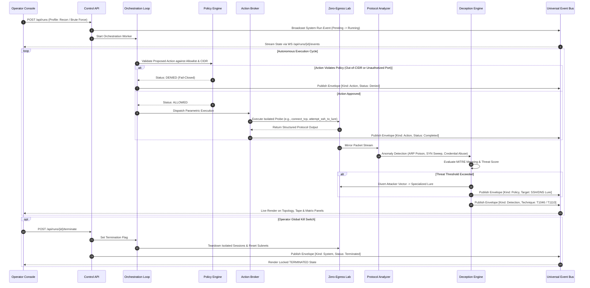

# NetMirage: An Innovative Approach to Defensive Cyber-Ranges via Zero-Egress Sandboxing and Real-Time MITRE ATT&CK Mapping

## Academic Metadata

- **Course**: BACSE203 P — Computer Networks Lab (Innovative Lab Assessment)
- **Institution**: Vellore Institute of Technology (VIT), Vellore
- **Faculty Guide**: Dr. Sudha M, Professor, School of Computer Science and Engineering
- **Contributors**:
  - Abhisumat Panda (`25BYB0202`)
  - Atharva Parmar (`25BYB0180`)
  - Manas Patel (`25BYB0190`)
  - Varun Agarwal (`25BYB0186`)

---

## 1. System Overview

**NetMirage** is an autonomous defensive cyber-range platform engineered to evaluate network intrusion detection, dynamic honeypot deception routing, and adversarial behavior within strict, zero-egress isolated network topologies.

Traditional cyber-ranges present significant security risks through host contamination, accidental external command-and-control (C2) leakage, or unpredictable AI execution. NetMirage addresses these vulnerabilities through three foundational engineering pillars:

1. **Zero-Egress Sandboxing**: Network virtualization strictly configured with `internal: true` bridges spanning five segmented VLANs (`10.0.10.0/24` to `10.0.50.0/24`). No packets can leave the virtualized bridge interfaces to reach external networks or host loopbacks.
2. **Deterministic & Parametric Safety Policy Engine**: The AI Planner operates exclusively through a strictly allowlisted catalogue of 7 actions (`discover_lab_services`, `resolve_dns`, `connect_tcp`, `request_http`, `attempt_ssh_to_lure`, `send_icmp_probe`, `inspect_session_output`). Arbitrary shell access, raw string execution, and unmapped ports are rejected immediately by a fail-closed policy engine.
3. **Passive Protocol Intelligence & Dynamic Deception Routing**: Real-time packet parsing (Scapy/Zeek engine) extracts Layer-2 to Layer-7 anomalies (ARP cache manipulation, TCP half-open SYN sweeps, DNS tunneling, credential attacks), classifies them into MITRE ATT&CK techniques, and dynamically updates deception routing rules to divert adversary traffic into specialized decoys (Cowrie SSH, Web, DNS sinkholes, SMTP sinks).

---

## 2. Architecture & Event Sequences

### Subsystem Architecture

```mermaid
flowchart LR
    subgraph UI["Operator Web Console [100vh]"]
        DASH["Hardware Telemetry Grid\n#FAF5E9 / #009B4D / #FFCC00"]
    end

    subgraph CTRL["Control & Orchestration Layer"]
        API["FastAPI Control API\n:8000"]
        BUS["Universal Event Bus\nPub/Sub & WebSocket Broadcast"]
        STORE[("Immutable Event Store\nSQLite / PostgreSQL Engine")]
    end

    subgraph ADVERSARY["Adversary Engine & Safety Broker"]
        PLANNER["AI / State-Machine Planner\nRecon -> Probe -> Exploit"]
        POLICY["Safety Policy Engine\nFail-Closed CIDR / Port Filter"]
        BROKER["Action Broker\nParametric Execution Translation"]
    end

    subgraph LAB["Zero-Egress Docker Lab (internal: true)"]
        EDGE["Edge VLAN\n10.0.10.0/24"]
        SSH_VLAN["SSH Lure VLAN\n10.0.20.0/24"]
        WEB_VLAN["Web Lure VLAN\n10.0.30.0/24"]
        SERV_VLAN["Services VLAN\n10.0.40.0/24"]
        MON_VLAN["Monitor VLAN\n10.0.50.0/24"]
    end

    subgraph INTEL["Protocol Intelligence & Deception"]
        SNIFF["Passive Protocol Analyzer\nScapy / Zeek Telemetry Pipeline"]
        MITRE["MITRE ATT&CK Classifier\nT1046, T1190, T1110, T1095"]
        DECEPT["Dynamic Deception Engine\nThreat Scoring & Route Diverter"]
    end

    DASH <-->|REST & WebSocket| API
    API --> BUS
    BUS --> STORE
    API --> PLANNER
    PLANNER -->|Action Request| POLICY
    POLICY -->|Approved Request| BROKER
    POLICY -.->|Denied Request| BUS
    BROKER -->|Synthetic Probe / Lure Access| LAB
    LAB -->|Raw Traffic Flow| SNIFF
    SNIFF -->|Observations| MITRE
    MITRE -->|Techniques & Confidence| DECEPT
    DECEPT -->|Route Updates| LAB
    DECEPT -->|Telemetry Envelopes| BUS
```



### Real-Time Execution Sequence



---

## 3. Disposable Lab Network Topology

The experimental cyber-range utilizes five zero-egress Docker bridge networks. Each segment operates on a dedicated sub-interface without default gateways to the host or internet:

| Segment | Subnet CIDR | Security Zone | Primary Purpose | Hosted Services & Decoys |
| :--- | :--- | :--- | :--- | :--- |
| `edge` | `10.0.10.0/24` | Entry Zone | Adversary staging, gateway emulation | Edge Gateway (`10.0.10.42`), Simulated Adversary Agent (`10.0.10.15`) |
| `ssh` | `10.0.20.0/24` | Interactive Lure | High-interaction SSH credential capture | Cowrie SSH Honeypot (`10.0.20.10:2222`), Auto-credential redaction |
| `web` | `10.0.30.0/24` | Decoy Portal | Emulated web vulnerability target | Decoy Admin Portal (`10.0.30.10:80`), Path traversal & SQLi sinks |
| `services` | `10.0.40.0/24` | Infrastructure Decoy | Corporate service emulation & DNS sinks | Internal DNS Decoy (`10.0.40.10:53`), Internal SMTP Sink (`10.0.40.20:25`) |
| `monitor` | `10.0.50.0/24` | Observation Zone | Passive packet mirroring & quarantine sink | Passive Telemetry Tap (`10.0.50.10`), Isolation Sinkhole (`10.0.50.99`) |

---

## 4. Repository Structure

```text
c:/Users/varun/Projects/cn project/
├── .agents/
│   └── skills/                         # Subsystem engineering runbooks
│       ├── 01_database_and_contracts.md
│       ├── 02_safety_and_broker.md
│       ├── 03_docker_lab_and_intel.md
│       ├── 03_docker_lab_and_lures.md
│       ├── 04_frontend_design_system.md
│       ├── 04_telemetry_mitre_deception.md
│       └── 05_dashboard_ui.md
├── app_build/
│   ├── backend/                        # Python FastAPI Backend & Subsystems
│   │   ├── core/
│   │   │   ├── action_broker.py        # Narrow parametric execution engine
│   │   │   └── safety_policy.py        # Fail-closed CIDR/port policy engine
│   │   ├── intel/
│   │   │   ├── credential_redactor.py  # Regex & dictionary credential sanitizer
│   │   │   ├── deception_policy.py     # Threat scoring & dynamic route re-routing
│   │   │   ├── honeypot_adapters.py    # Cowrie SSH, Web, DNS, SMTP normalization
│   │   │   └── protocol_analyzer.py    # Layer-2 to Layer-7 anomaly detection
│   │   ├── orchestration/
│   │   │   └── planner.py              # Adversary planner & execution coordinator
│   │   ├── tests/                      # Automated unit, integration & live tests
│   │   │   ├── live_smoke_test.py      # Live end-to-end programmatic verification
│   │   │   ├── test_api_and_db.py
│   │   │   ├── test_docker_policy.py
│   │   │   ├── test_intel_and_deception.py
│   │   │   ├── test_milestone1_e2e.py
│   │   │   └── test_safety_and_broker.py
│   │   ├── config.py                   # Pydantic BaseSettings & env resolution
│   │   ├── db.py                       # SQLAlchemy async/sync SQLite engine
│   │   ├── event_bus.py                # In-memory pub/sub & WebSocket fan-out
│   │   ├── main.py                     # FastAPI application entrypoint
│   │   ├── models.py                   # 6 immutable database entity models
│   │   ├── requirements.txt            # Python dependencies
│   │   ├── routes.py                   # REST endpoints & WebSocket handler
│   │   └── schemas.py                  # Pydantic v2 validation contracts
│   ├── docker/                         # Zero-Egress Docker Compose Lab
│   │   ├── cowrie-ssh-lure/            # Cowrie SSH honeypot container
│   │   ├── dns-smtp-lure/              # DNS and SMTP decoy container
│   │   ├── edge-gateway/               # Virtualized edge router container
│   │   ├── telemetry-collector/        # Scapy packet collector container
│   │   ├── web-lure/                   # Decoy web portal container
│   │   └── docker-compose.lab.yml      # Multi-VLAN zero-egress compose definition
│   ├── frontend/                       # React 18 + Vite + TypeScript Console
│   │   ├── src/
│   │   │   ├── __tests__/              # Vitest console verification suite
│   │   │   │   └── dashboard.test.tsx
│   │   │   ├── components/             # Swiss-Industrial Hardware Telemetry Panels
│   │   │   │   ├── AttackerTerminal.tsx# [02] Action Broker Tape (Wireshark-density)
│   │   │   │   ├── DetectionsMatrix.tsx# [03] MITRE ATT&CK & Deception Grid
│   │   │   │   ├── HoneypotInspector.tsx# [04] Honeypot Sessions & Payload Drawer
│   │   │   │   ├── NetworkTopology.tsx # [01] Schematic VLAN Topology Canvas
│   │   │   │   └── TopControlBar.tsx   # Tactile industrial switch command strip
│   │   │   ├── services/
│   │   │   │   ├── api.ts              # REST client wrapper
│   │   │   │   └── websocket.ts        # Resilient WebSocket connection manager
│   │   │   ├── App.tsx                 # Full-viewport (100vh) zero-waste layout
│   │   │   ├── index.css               # Hardware tokens, dot-matrix & scrollbars
│   │   │   ├── main.tsx                # React DOM mount point
│   │   │   └── types.ts                # TypeScript interfaces & API contracts
│   │   ├── package.json
│   │   ├── tailwind.config.js          # Tailored Ivory/Green/Tangerine palette
│   │   └── vite.config.ts              # Vite dev server & proxy configuration
│   ├── start_netmirage.ps1             # Single-command launcher (Windows)
│   └── start_netmirage.sh              # Single-command launcher (Linux / macOS)
├── docs/                               # Detailed Technical Documentation
│   ├── API_AND_CONTRACTS.md            # Complete REST, WebSocket & Envelope specs
│   ├── ARCHITECTURE.md                 # 10 core subsystem engineering specifications
│   └── SECURITY_BOUNDARIES.md          # Zero-egress isolation & safety invariants
├── production_artifacts/               # Architecture artifacts, audit logs & specs
│   ├── api_contract.json
│   ├── lab_schema.json
│   ├── live_audit_report.md            # Live integration & UI audit log
│   ├── openapi.json                    # Full OpenAPI 3.1.0 schema
│   └── verification_report.md
├── .env.example                        # Template configuration file
├── .gitignore                          # Strict secret & build cache exclusion
├── AGENTS.md                           # Multi-agent architectural constraints
├── Makefile                            # Unified build, test, and run automation
└── package.json                        # Root workspace scripts
```

---

## 5. Quickstart & Launch Guide

### Prerequisites
- Python 3.11+
- Node.js 18+ and npm
- Docker Engine & Docker Compose v2 (Optional for full containerization; deterministic emulation is enabled automatically if Docker is absent)

### 1. Clone & Configure Environment

```bash
git clone https://github.com/varunagarwal13/CN-PROJECT.git
cd CN-PROJECT

# Copy template environment file
cp .env.example .env
```

### 2. Single-Command Launch

#### On Linux / macOS:
```bash
chmod +x app_build/start_netmirage.sh
bash app_build/start_netmirage.sh
```

#### On Windows (PowerShell):
```powershell
Set-ExecutionPolicy -Scope Process -ExecutionPolicy Bypass
.\app_build\start_netmirage.ps1
```

#### Via Root Makefile:
```bash
make setup
make start
```

### 3. Manual Component Launch

#### Backend Service:
```bash
python -m venv app_build/backend/.venv

# Activate venv
# On Windows:
.\app_build\backend\.venv\Scripts\Activate.ps1
# On Linux/macOS:
source app_build/backend/.venv/bin/activate

pip install -r app_build/backend/requirements.txt
python -m uvicorn app_build.backend.main:app --host 0.0.0.0 --port 8000 --reload
```

#### Frontend Console:
```bash
cd app_build/frontend
npm install
npm run dev -- --host 0.0.0.0 --port 5173
```

### 4. Service Access Points

- **Operator Web Console**: `http://localhost:5173`
- **Control API & Health**: `http://localhost:8000/api/health`
- **Interactive OpenAPI Documentation**: `http://localhost:8000/docs`
- **WebSocket Event Stream**: `ws://localhost:8000/api/runs/{run_id}/events`

---

## 6. Verification & Test Execution

Run the complete backend, frontend, and live programmatic test suites:

### Complete Suite via Makefile
```bash
make test
```

### Backend Test Suite (`pytest` - 24 Tests)
```bash
.\app_build\backend\.venv\Scripts\python.exe -m pytest app_build/backend/tests -v
```
*Expected: 24 passed in < 1.0s.*

### Live Programmatic Integration Audit
```bash
.\app_build\backend\.venv\Scripts\python.exe app_build/backend/tests/live_smoke_test.py
```
*Expected: 5/5 verification stages passed (Health, Topology, Run WebSocket Streaming, Interactive Controls, DB Persistence & Sanitization).*

### Frontend Test Suite (`vitest` - 8 Tests) & Production Build Check
```bash
cd app_build/frontend
npm test -- --run
npm run build
```
*Expected: 8 passed in < 0.5s; TypeScript compilation clean (`tsc && vite build`).*
